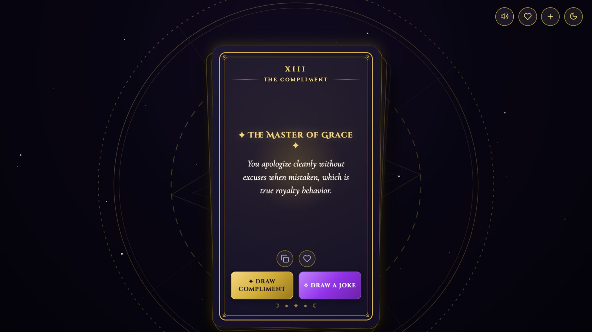

# Mystic Tarot — Compliments & Jests

**A tarot-style deck that deals kind compliments and family-friendly jokes, with tactile 3D card draws.**

Affirmation generators are usually just a line of text in a box. Mystic Tarot is my take on that idea: each draw is a small ritual. A card lifts off a layered deck, flips with a reader's flourish and lands face-up, with synthesized card sounds and a celestial astrolabe turning in the background.

### ▶ [Draw a card](https://bryantheburrows.github.io/compliments-generator/)



Designed and built by **Bryan Burrows** with AI coding assistants. It's part of my AI product and UX design portfolio.

---

## Features

**The deck**
- A layered 3D card stack in classic tarot proportions, with paper-edge bevels and a recoil when a card is drawn
- A reader's-flip draw animation: the card lifts, turns over and settles face-up
- Card sounds (linen slides, snaps and chimes) synthesized live with the Web Audio API, with no audio files. Sound can be muted.

**The content**
- **100 compliments**, each with its own tarot-style title
- **50 jokes** with a suspense beat before the punchline
- **Write your own cards** and add them to your deck

**Handy extras**
- Save favourite cards and browse them in a slide-up drawer
- Copy any card to the clipboard to share it
- Switch between the dark Midnight theme and the light Parchment theme
- Works on desktop and mobile, with keyboard shortcuts

### Keyboard shortcuts

| Key | Action |
|---|---|
| <kbd>Space</kbd> | Draw a compliment |
| <kbd>J</kbd> | Draw a joke |

Favourites, custom cards and the theme are saved in your browser's `localStorage`. Nothing is sent to a server.

## How it was built

I led the concept, art direction and interaction design, and I built it with AI coding assistants. I directed the work in small, reviewable steps and checked each change in the browser.

The design brief I set:

- **Make it feel physical.** The deck has depth, weight and sound, so drawing a card feels like a small moment rather than a page refresh.
- **Pace the joke.** Joke cards pause on pulsing stars before the punchline, the way a person would tell it.
- **Keep it light.** It's one HTML file with no frameworks, no build step and no audio or image downloads beyond the fonts.

## Tech stack

- HTML, CSS and vanilla JavaScript in a single `index.html`, with no framework or build step
- CSS 3D transforms, custom properties for theming, and keyframe animations
- Web Audio API for procedural sound effects
- Canvas for sparkle particles and inline SVG for the astrolabe and icons
- Fonts: Cinzel Decorative, Cinzel, Cormorant Garamond and Outfit from Google Fonts

## Run it locally

There's nothing to install.

```bash
git clone https://github.com/BryantheBurrows/compliments-generator.git
cd compliments-generator
open index.html
```

On Windows or Linux, open `index.html` in any modern browser instead of using `open`. The live site is served by GitHub Pages from the `main` branch.

## Project structure

```
compliments-generator/
├── index.html           The whole app: markup, styles and scripts
├── favicon.svg          Browser tab icon
└── docs/screenshot.jpg  Screenshot used in this README
```

## License

[MIT](LICENSE) © Bryan Burrows
